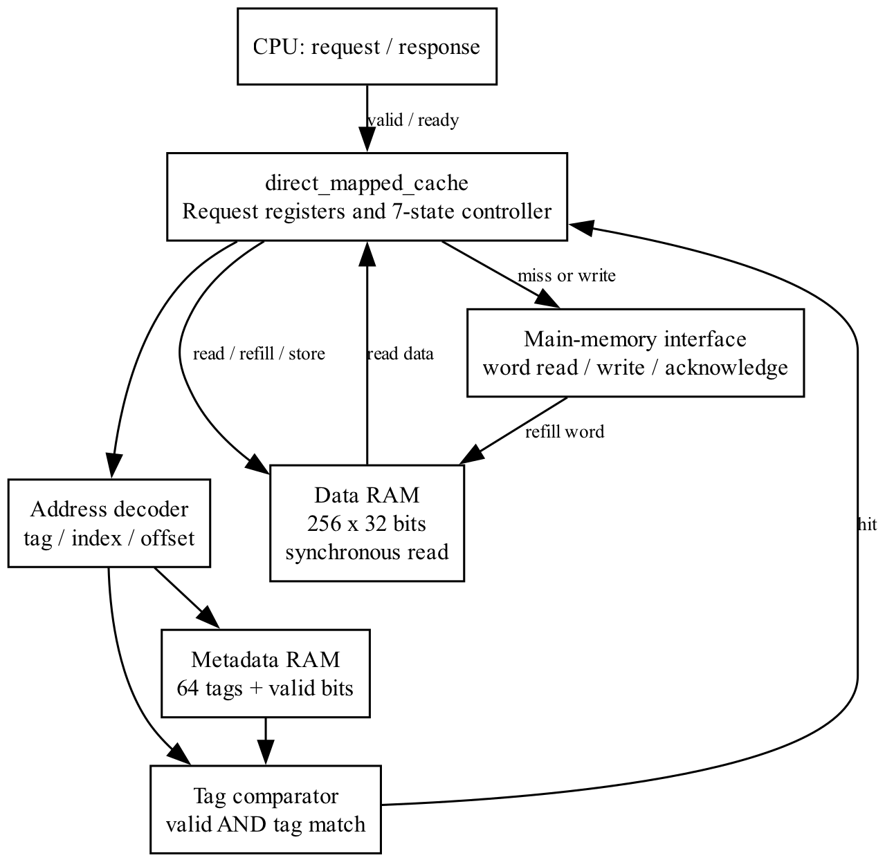

# Direct-Mapped Cache Controller

A Verilog implementation of a direct-mapped cache between a CPU and main memory.
The cache stores recently accessed memory blocks so later requests can reuse data
without fetching it from main memory again. The project explores how spatial
locality, temporal locality and address conflicts affect hit rate and response
latency.

## Cache organization

| Property | Configuration |
|---|---|
| Data capacity | 1 KB |
| Cache lines | 64 |
| Block size | 16 bytes, containing four 32-bit words |
| Address width | 32-bit byte addresses |
| Supported accesses | Aligned 32-bit reads and writes |
| Mapping | Direct-mapped: one possible cache line per memory block |
| Write policy | Write-through with no-write-allocate |
| Outstanding CPU requests | One |

Each address contains a **22-bit tag**, a **6-bit index** and a **4-bit offset**.
The index selects one of the 64 lines. The tag identifies the memory block stored
there. The offset selects a word and byte position within the block; supported
word accesses have their lowest two address bits set to zero.

A request hits when the selected line is valid and its stored tag matches the
requested tag. Addresses 0 and 1024 select the same line with different tags, so
alternating between their blocks causes conflict misses.

## Architecture

The implementation separates address decoding, tag comparison, metadata storage,
data RAM and controller logic into Verilog modules. The data RAM uses a
synchronous read port and a separate synchronous write port. Metadata stores a
tag and valid bit for each line.

CPU requests, CPU responses and memory requests use valid-ready handshakes.
Transfers occur on a rising clock edge when both signals are high. A stalled
request or response holds its valid signal and payload stable. Each accepted
memory request receives one registered response pulse.

## Controller operation

The controller uses seven states: `IDLE`, `LOOKUP`, `REFILL_REQ`, `REFILL_WAIT`,
`WRITE_REQ`, `WRITE_WAIT` and `RESPONSE`.

- **Read hit:** return the selected cached word.
- **Read miss:** invalidate the selected line, fetch all four words serially,
  and install the new tag and valid bit after the final word arrives.
- **Write hit:** update the cached word and backing memory.
- **Write miss:** update backing memory while preserving the existing cache line.
- **Response:** hold the result until the CPU accepts it.

Write requests complete after memory acknowledges the write. Synchronous reset
invalidates all lines and cancels outstanding controller work. The memory
interface must reset or cancel its outstanding work alongside the cache.

## Verification

Eight deterministic workloads exercise cold misses, block offsets, sequential
reads, repeated reads, conflicts, random reads, mixed reads and writes, and a
write stream. Independent Verilog and Python reference models check returned
data and hit decisions. Tests also check backing-memory contents, stalled
interfaces and reset behavior.

Two cache configurations, the no-cache baseline and the synthesized FPGA
netlist account for **18,504 checked transactions**, plus separate reset tests.
All 18 directed-trace response handshakes are also checked against the waveform.

## Results

| Workload | Hit rate | Cache response cycles | No-cache response cycles |
|---|---:|---:|---:|
| Repeated reads | 96.88% | 4.932 | 9.004 |
| Sequential reads | 75.00% | 11.497 | 9.002 |
| Conflicting reads | 0.00% | 33.988 | 9.008 |

Repeated reads improve mean response latency by **1.826 times** because most
requests reuse cached data. Sequential and conflict accesses are slower than
the baseline in this memory model: a cache miss fetches four words serially,
while an uncached request fetches one. A higher hit rate therefore does not
always produce a lower response latency.

Reference synthesis and routing for a **Lattice iCE40 HX8K** use **610 logic
cells** and **four block RAMs**. Estimated internal maximum frequency is
**75.35 MHz**, meeting the 25 MHz target. These are tool estimates with automatic
IO placement, rather than measurements from a physical FPGA board.

## Scope and extensions

The controller supports one outstanding request, aligned word accesses and a
shared clock. It does not implement byte stores, burst refill, a write buffer,
cache coherence or memory-error handling. Burst transfers could reduce serial
refill overhead, while a write buffer could reduce the time the CPU waits for
writes to reach memory.
