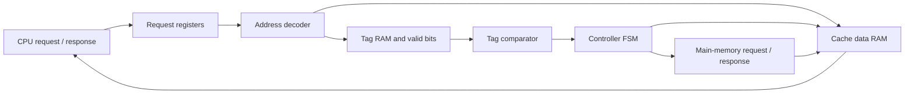
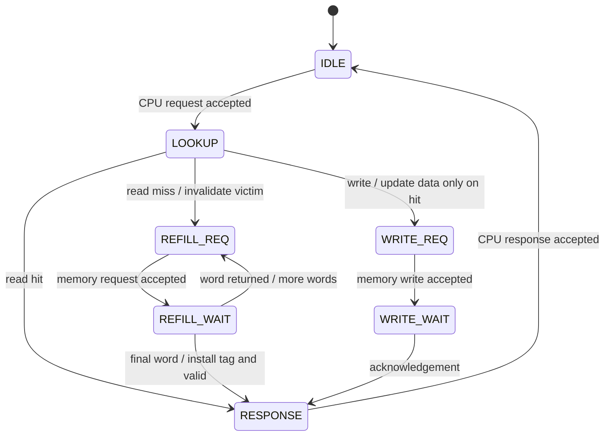

# Architecture and controller state machine

The suggested modules are represented as sections inside one RTL module.
This keeps storage writes and controller sequencing together while preserving
clear architectural responsibilities.





Every request state holds its outputs while ready is low. Every wait state holds
until its response arrives. RESPONSE holds while CPU response-ready is low.
Synchronous reset takes every state to IDLE and clears all valid bits.

## Default address layout

```text
 31                         10 9                 4 3       2 1       0
+-----------------------------+-------------------+---------+---------+
|          tag (22)           |     index (6)     | word (2)| byte (2)|
+-----------------------------+-------------------+---------+---------+
                                  offset = word + byte = 4 bits
```

For address A: block=A/16, index=block mod 64, tag=A/1024,
word=(A/4) mod 4, block base=A & 0xfffffff0.

| Suggested block | RTL representation |
|---|---|
| Cache Data RAM | `data_ram`, 256 x 32 bits |
| Tag RAM | `tag_ram`, 64 x 22 bits |
| Valid-Bit RAM | `valid_ram`, 64 x 1 bit |
| Address Decoder | `line_index`, `word_offset`, `address_tag`, `block_base` |
| Tag Comparator | `lookup_hit` |
| Cache Controller FSM | `state` and sequential `case` |
| Main-Memory Interface | `mem_req_*`, `mem_rsp_*` |
