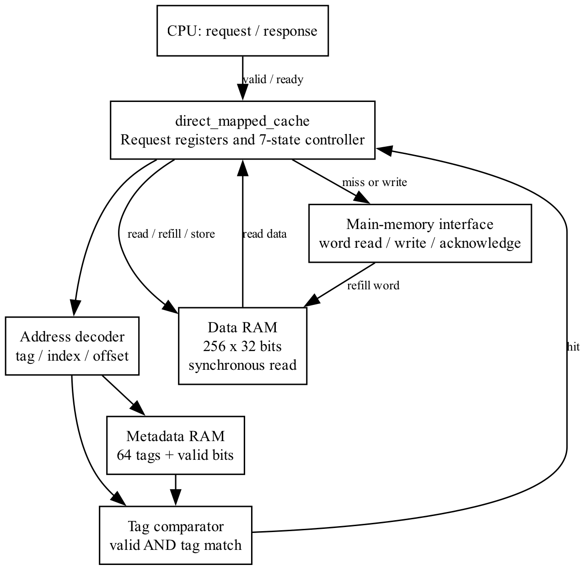
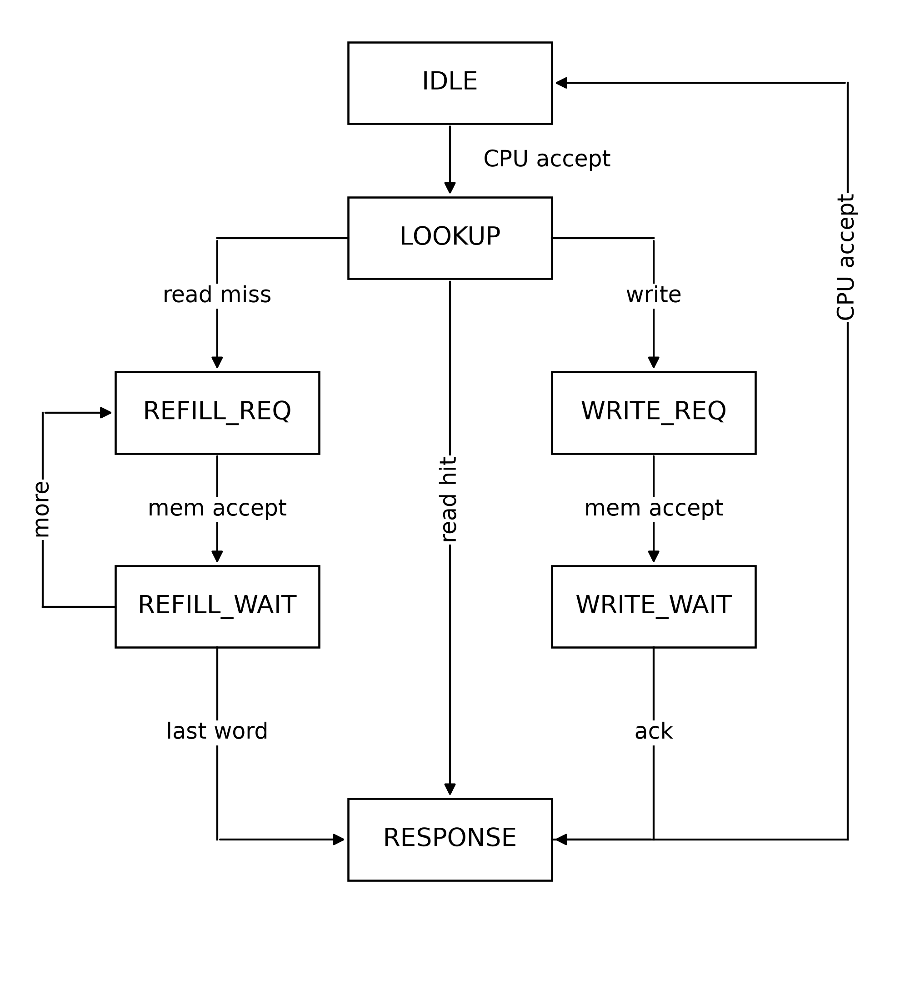
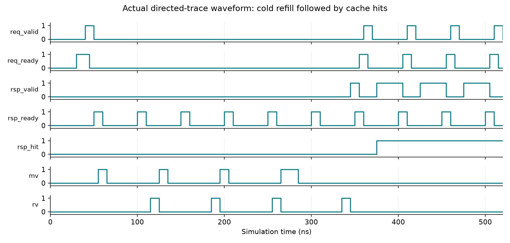

# Design and Verification of a Direct-Mapped Cache Controller

## Modern Computer Architecture — B.Tech (CS & AI)

| Field | Detail |
|---|---|
| **Student Names** | Shaurya Sharma · Lakshay Saharan |
| **Roll Numbers** | 2401010439 · 2401020034 |
| **Course** | Modern Computer Architecture — B.Tech (CS & AI) |
| **Submission Date** | November 2026 |

---

## Abstract

This project implements a blocking direct-mapped cache controller in synthesizable
Verilog. The default cache stores 1 KB of data in 64 lines with 16-byte blocks and
uses 32-bit byte addresses. A seven-state controller supports aligned word reads and
writes using write-through and no-write-allocate. Modular storage, decoding and tag
comparison separate the controller from its datapath. Independent Verilog and Python
reference models check data and hit/miss behavior across eight workloads and two
cache geometries. A no-cache baseline and a mapped FPGA netlist provide additional
comparisons. Repeated reads achieve a **96.88% hit rate** and a **1.826× response-latency
speedup** relative to the baseline. Reference-device place and route estimates a maximum
internal clock frequency of **75.35 MHz**. The results quantify locality benefits and
show the latency cost of serial block refill under unfavorable access patterns.

**Index Terms** — Direct-mapped cache, Verilog, memory hierarchy, FPGA, AMAT.

---

## I. Introduction

A cache can reduce memory-access latency when an access stream reuses data or visits
nearby addresses [1]. Direct mapping assigns each memory block to one cache line,
reducing lookup complexity while exposing conflict misses. The objective is to implement
correct lookup and refill and relate observed hit rates to explicit timing assumptions.
The design is a standalone controller, not a complete processor. It accepts one outstanding
CPU request and exposes a word-oriented backing-memory interface.

This report presents the architecture, controller behavior, verification method, baseline
comparison and reference FPGA results. The responsibilities of the two project members are
summarized in Section VI.

---

## II. Literature Review

Cornell CS 3410's cache notes describe locality, direct mapping, tag/index/offset fields,
conflict misses and write-policy choices [1]. These concepts motivate the small cache and
the locality/conflict experiments used here. A line's valid bit prevents an uninitialized
entry from appearing to contain a useful block.

Write-through sends every store to backing memory, while no-write-allocate avoids loading
a block on a store miss [1]. This combination removes dirty-block eviction control but
makes write completion depend on memory acknowledgement. The standard read AMAT model
combines hit time with miss rate times additional miss penalty. This project derives its
cycle costs from the actual FSM.

Icarus Verilog documents simulation models and testbenches as a way to exercise hardware
behavior [2]. The project uses separate Verilog and Python oracles. Yosys describes the
synthesis of coarse-grain memory and logic into lower-level representations [3]. The
nextpnr flow adds target-specific placement, routing and timing analysis [4]. Simulation,
generic synthesis and reference-device timing are reported as distinct forms of evidence.

---

## III. Proposed Solution

### A. Organization and Address Fields

The cache contains 1024/16 = 64 lines and four 32-bit words per block. The 32-bit address
splits into a 22-bit tag, a 6-bit index and a 4-bit byte offset. The offset consists of
two word-selection bits and two byte-selection bits; supported requests set the lowest two
bits to zero.

| Field | Address bits | Width |
|---|---|---|
| Tag | [31:10] | 22 |
| Index | [9:4] | 6 |
| Word offset | [3:2] | 2 |
| Byte offset | [1:0] | 2 |

Data storage is 8192 bits, tag storage is 1408 bits and valid storage is 64 bits. These
9664 logical storage bits exclude control registers. For byte address A,
`index = (A/16) mod 64` and `tag = A/1024`, using integer division. Addresses 0 and 1024
therefore share index zero with different tags.

The module hierarchy comprises `direct_mapped_cache`, `cache_address_decoder`,
`cache_tag_comparator`, `cache_metadata` and `cache_data_ram`. The top module contains the
request registers, FSM and memory interface. The data RAM has a synchronous read port and
a separate synchronous write port, permitting block-RAM inference. The incoming CPU address
selects the RAM word at request acceptance; LOOKUP uses that registered value on the next
edge. Metadata clears valid bits on reset.



### B. State Transitions

The controller uses seven states. IDLE accepts a request and LOOKUP classifies it. A read
hit prepares RESPONSE. A read miss invalidates the victim and alternates REFILL_REQ with
REFILL_WAIT to fetch all words. The final word installs the tag and valid bit. The
requested word is saved for the CPU while refill continues.

| State | Main action | Completion transition |
|---|---|---|
| IDLE (0) | Accept and latch a CPU request | LOOKUP |
| LOOKUP (1) | Check valid/tag and classify hit/miss | RESPONSE, REFILL_REQ or WRITE_REQ |
| REFILL_REQ (2) | Hold one word-read request | REFILL_WAIT on memory ready |
| REFILL_WAIT (3) | Store returned word | Next request or RESPONSE after last word |
| WRITE_REQ (4) | Hold one word-write request | WRITE_WAIT on memory ready |
| WRITE_WAIT (5) | Wait for write acknowledgement | RESPONSE |
| RESPONSE (6) | Hold CPU data and hit status | IDLE on CPU ready |



On a write hit, the controller updates the cached word and memory. On a write miss it
updates only memory and preserves the existing cache line. WRITE_REQ holds the memory
request and WRITE_WAIT waits for acknowledgement. RESPONSE holds data and hit status until
CPU acceptance. Write response data is zero.

### C. Interface Contract

A request transfers on a rising edge when valid and ready are both high. Payload and valid
remain stable while ready is low. CPU responses follow the same rule. The memory returns
one registered response pulse per accepted request, at least one edge later, without a
response-ready input. All interfaces share one clock. Active-high synchronous reset
invalidates the cache and aborts outstanding work; the memory interface must reset or
cancel old responses too.

---

## IV. Experimental Method

The test memory holds 64 KB and initializes word i to `0xA5A50000 XOR i`. It uses five
response-latency cycles and rejects requests every fourth model cycle. The test CPU accepts
responses only every fifth cycle. All traces use aligned word addresses and start from reset.

The eight workloads cover cold reads, every block-word offset, sequential reads, repeated
reads, alternating conflicting blocks, uniform random reads, mixed reads/writes and a write
stream followed by reads. Random generation uses seed 2026.

| Trace | Requests | Purpose |
|---|---:|---|
| directed | 18 | Cold miss, offsets, conflict, writes and last memory word |
| sequential | 1024 | One 4 KB sequential word-read pass |
| repeated | 512 | Eight passes over a 256-byte working set |
| conflict | 256 | Alternate reads at byte addresses 0 and 1024 |
| random | 1024 | Uniform word reads across 64 KB, seed 2026 |
| mixed | 1024 | Reads/writes over 8 KB, 35% write probability |
| write_stream | 512 | 256 stores followed by 256 reads of the same region |
| all_offsets | 256 | Each word position in every default cache line |

The primary testbench checks every result against independent data/tag scoreboards, checks
stall stability and verifies the complete backing memory. Python independently reconstructs
expected data, tags and traffic from traces. A dedicated reset test covers warm invalidation,
refill abort and held-response abort. Global timeouts prevent a hung controller from passing.

The two cache configurations (1024/16 and 512/32 bytes) account for **9,252 checked
transactions**. The no-cache baseline adds 4,626 transactions. The synthesized FPGA
primitive netlist adds another 4,626 transactions, whose CSVs match the RTL exactly,
including response latency. Thus **18,504 trace transactions** pass in total, in addition
to the reset scenarios. The baseline retains the CPU lookup stage and memory protocol but
sends one memory transaction per CPU request.

---



## V. Results and Discussion

### A. Hit and Miss Behavior

| Workload | Requests | Hits | Hit Rate |
|---|---:|---:|---:|
| all_offsets | 256 | 192 | 75.00% |
| conflict | 256 | 0 | 0.00% |
| directed | 18 | 9 | 50.00% |
| mixed | 1024 | 103 | 10.06% |
| random | 1024 | 14 | 1.37% |
| repeated | 512 | 496 | 96.88% |
| sequential | 1024 | 768 | 75.00% |
| write_stream | 512 | 192 | 37.50% |

Sequential reads achieve one miss and three hits per block, giving 768/1024 hits, or 75%.
The repeated trace fits a 256-byte working set in the cache; only its first 16 blocks miss,
giving 496/512 hits, or 96.875%. Alternating addresses 0 and 1024 produces a miss on every
access. Random references cover a much larger region and produce little reuse. These
finite-trace results do not claim a universal random-access rate.

### B. AMAT and Baseline Comparison

An ideal read hit takes two cycles from request acceptance to response acceptance. Each
serial memory word adds seven cycles: request/response sequencing plus the five-cycle
memory latency. A four-word read miss therefore takes 2 + 4 × 7 = 30 cycles; a write takes
2 + 7 = 9 cycles. With R reads, W writes, RM read misses and N = R + W, the ideal average is:

```text
AMAT = (2R + 28RM + 9W) / N  (1)
```

For sequential reads, AMAT = 2 + (256/1024) × 28 = 9 cycles. Repeated reads give 2.875
cycles and the conflict trace gives 30 cycles. Measured response time also includes
acceptance stalls and CPU response backpressure, but excludes driver idle gaps. It is not
processor CPI or whole-trace throughput.

| Workload | Cache cycles | Baseline cycles | Ratio |
|---|---:|---:|---:|
| repeated | 4.932 | 9.004 | 1.826× |
| sequential | 11.497 | 9.002 | 0.783× |
| conflict | 33.988 | 9.008 | 0.265× |
| random | 33.587 | 9.002 | 0.268× |
| mixed | 23.431 | 9.002 | 0.384× |

The ratio is baseline mean response latency divided by cache mean response latency. Repeated
reads benefit, but sequential and conflict accesses are slower than the baseline. A cache
miss transfers four serial words while an uncached read transfers one. A high hit rate alone
therefore does not guarantee a latency improvement under this memory model.

The alternative 512-byte cache with 32-byte blocks gives 87.5% sequential hits, but the
ideal sequential AMAT remains nine cycles: fewer misses each fetch twice as many words.
Because both capacity and block size change, this comparison does not isolate either
parameter.

### C. Synthesis and Reference FPGA Timing

Generic Yosys synthesis of the modular default cache produces **26,075 generic cells** after
flattening and removing scope metadata. These counts are distinct from FPGA resources.
Reference synthesis and routing use an iCE40 HX8K device, CT256 package, seed 1 and a
25 MHz clock target.

| Reference-device metric | Result |
|---|---|
| Logic cells | 610 / 7680 (7.94%) |
| Block RAMs | 4 / 32 (12.50%) |
| IO cells | 206 / 206 (100%) |
| Estimated post-route internal Fmax | **75.35 MHz** |
| Requested clock target | 25 MHz (met) |

The post-route estimate is taken from nextpnr's final JSON report. All IOs are automatically
placed and there are no external input/output delay constraints. The wide standalone interface
consumes all package IO cells; a practical board integration would need a narrower host
interface or an internal CPU connection. The reported Fmax concerns internal clocked paths
for this reference build. It is not a board measurement or a guarantee of external interface
timing. No FPGA board was supplied, and programming or physical demonstration was not performed.

---

## VI. Individual Contributions

| Member | Roll Number | Responsibilities |
|---|---|---|
| Shaurya Sharma | 2401010439 | RTL, memory model, testbenches, traces, simulation, performance analysis and synthesis |
| Lakshay Saharan | 2401020034 | Report, slides and video preparation |

---

## VII. Conclusion

The modular cache correctly performs direct-mapped lookup, refill, reset invalidation and
write-through transactions for the tested requests. Independent reference models, waveform
checks and mapped-netlist simulation provide consistent functional evidence. Locality
improves repeated-read response time, while serial refill exposes the cost of misses. The
reference FPGA flow meets a 25 MHz target and provides measured tool outputs for
resource/timing analysis.

Limitations include one outstanding request, aligned words only, no write buffer, no burst
refill, no memory errors and no coherence. Burst transfers and a write buffer are useful
extensions. Reproduce RTL and baseline verification with:

```sh
python3 scripts/run.py
```

For the reference FPGA flow:

```sh
python3 scripts/run_fpga.py
```

The repository includes the report, demonstration video, diagrams, source files and raw
evidence. Live presentation remains a student activity.

---

## References

[1] Cornell University, "Caches," CS 3410, Spring 2026. [Online]. Available:
https://www.cs.cornell.edu/courses/cs3410/2026sp/notes/caches.html

[2] Icarus Verilog, "Simulation Using Icarus Verilog." [Online]. Available:
https://steveicarus.github.io/iverilog/usage/simulation.html

[3] YosysHQ, "Synthesis in detail," Yosys Documentation. [Online]. Available:
https://yosyshq.readthedocs.io/projects/yosys/en/stable/using_yosys/synthesis/index.html

[4] YosysHQ, "nextpnr: FPGA place and route." [Online]. Available:
https://github.com/YosysHQ/nextpnr
